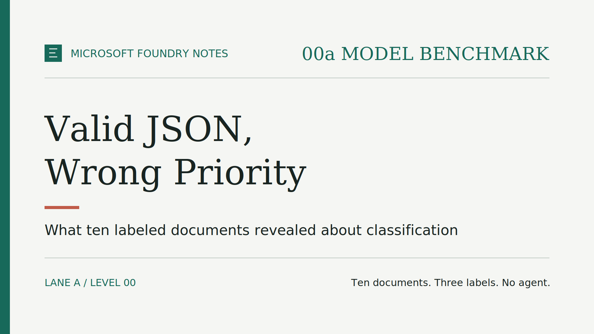

# Microsoft Foundry Notes: 00a Model Benchmark — Valid JSON, Wrong Priority

Ten documents went into the model. Ten valid classifications came back. Only
six matched all three expected labels.

After [building Microsoft Foundry Core](published/episode-00a-foundry-core.md) and
[calling its model for the first time](published/episode-00a-chat-completions.md), I wanted
to ask a different question. Not "Can this caller get an answer?" but "How
often does the answer match what this task expects?" This small experiment
uses the public 00a deployment of **gpt-4.1-mini (2025-04-14)** and scores
its predictions with **Microsoft Foundry Evaluation**. This model supports
fine-tuning, so the run provides an untuned baseline for a future
before-and-after experiment. The benchmark creates no agent or additional
model deployment.

> **TL;DR**
>
> - **Ten labeled documents:** a fixed, synthetic sample covering six document types.
> - **One fine-tunable base model:** gpt-4.1-mini (2025-04-14), before training.
> - **Foundry-first evaluation:** the client uses Foundry's built-in
>   string-check graders rather than a custom scoring service.
> - **Three decisions per document:** type, destination department, and priority.
> - **Complete responses, incomplete accuracy:** 100% valid responses; 100% type,
>   100% department, 60% priority, and 60% with all three fields correct.
> - **The important miss:** a privacy request labeled Critical was returned
>   as High. A valid output format does not establish safe prioritization.
> - **A first signal, not a scorecard:** this sample is too small to establish
>   production accuracy, and the prompt does not define a routing policy.

## Why benchmark a working model?

A successful Chat Completions request proves a narrow path: the authorized
caller reached the deployment and received a response. It says nothing about
whether that response is useful for a particular business task.

Here the task is document triage. Each source item has its text and three
reference labels: document type, department, and priority. I took the first ten
items from a set of 100 synthetic business documents. This fixed subset
includes all six types: four appear twice and two appear once. It is
reproducible, but it is not a random or statistically representative sample.
The text and labels are packaged with the local application; the full set of
100 is not needed to run this benchmark.

*The model produces predictions; Microsoft Foundry Evaluation now compares them
with reference labels using built-in exact string checks. The model does not
see the expected labels in its request.*

The same Azure CLI user authorized in scenario 00a calls its gpt-4.1-mini
deployment through Microsoft Entra ID. There is no API key. The client sends
one document per request and asks for a classification in a strict JSON
Schema, with allowed values taken from the sample. The resulting report contains
the source index and labels, not the document text. The current client submits
valid predicted and expected labels to an evaluation run in the Foundry
project; only coverage and data preparation remain local. The run persists
in Foundry and requires the caller's project evaluation role. Model inference
and evaluation both ran in the existing 00a environment in Italy North;
no fine-tuning job has been started.

That schema is useful: it constrains the shape and allowed values of a
response. It cannot tell the model which *valid* label is correct.

## The result: format is not the finish line

In the live gpt-4.1-mini run on 2026-10-02, all ten requests returned usable
classifications. **Coverage was 10 out of 10.** There were no refusals,
malformed responses, or reported request errors. Foundry's native
string-check graders compared the predicted labels with their references:

- **Document type: 10/10.** Invoices, contracts, resumes, complaints, the
  purchase order, and the data access request were identified by type.
- **Department: 10/10.** Both contracts went to Legal, and every other
  destination matched its reference label.
- **Priority: 6/10.** Four priorities differed from the reference labels.
- **All three together: 6/10.** A document counts here only when every field
  matches.

Both contracts were correctly sent to Legal but assigned Medium rather than
the expected High priority. One invoice moved from Medium to High, while
the privacy request moved from Critical to High. These are not equivalent
mistakes. If priority controlled a time-sensitive queue, the last downward
change would deserve particular attention. The benchmark does **not**
establish what deadline or legal response the request requires.

The report separates **coverage** from **accuracy**. Coverage divides valid
classifications by all ten documents. Each accuracy divides exact matches by
valid classifications; invalid responses would be recorded as errors and
excluded from that accuracy denominator. Always read both numbers together.
Here all ten responses were valid, so the denominators happen to be the same.
This is one run; repeating it would help assess prediction variability before
drawing conclusions from any later score change.

> **A structured response can be perfectly valid and still be wrong for the
> task.** Format validation catches a different class of failure from checking
> a decision against a reference answer.

## What the numbers do not tell us

Ten examples are enough to reveal a concrete failure, not to estimate how
often it will occur in real work. There is only **one** Critical example, so
this run cannot establish performance on Critical requests as a group. The
sample's expected labels are the benchmark's answer key, not independent
proof that every routing decision is the right business policy.

The prompt names the three fields but provides no detailed rules for assigning
department or priority. Although department matched every reference label
in this run, both contracts received a lower priority than expected. Before
training or claiming a general weakness, I would review the answer key with
the process owner, write explicit routing and severity criteria, and preserve
these examples for comparison. Only then would I expand to more diverse
documents and repeat runs to check variability.

This client does not retrieve company policies, consult tools, retain memory,
or measure latency, token consumption, or cost. It uses synthetic documents
because the public 00a endpoint and this small experiment are not a substitute
for an approved sensitive-data handling design. No new Azure model deployment
is created, but the current client creates a persistent Foundry evaluation
and run containing labels. Live model requests and evaluations can incur charges.

## Try it yourself

This companion requires a provisioned **public lane 00a** from
[release episode-00a-model-benchmark-v1.0.0](https://github.com/gderossilive/msfoundrynotes/releases/tag/episode-00a-model-benchmark-v1.0.0)
and the authorized
Azure CLI caller from the previous application episode. It does not create a
new lane or require an agent. The [scenario 00a
README](https://github.com/gderossilive/msfoundrynotes/blob/episode-00a-model-benchmark-v1.0.0/scenarios/00-foundry-core/00a-foundry-core-public/README.md) explains
deployment and cleanup; the [application
README](https://github.com/gderossilive/msfoundrynotes/blob/episode-00a-model-benchmark-v1.0.0/scenarios/00-foundry-core/app/README.md#document-classification-benchmark-00a)
has the environment setup and benchmark command. Use the whole repository,
not an isolated script: the deployment and client depend on the scenario
structure. Current-source provisioning adds the caller's project role for
Foundry evaluations. An existing deployment may already grant it through
inheritance; check before reprovisioning. The model-inference role alone is
not enough to create evaluation runs.

1. **Check the deployment.** Confirm your 00a environment has a model
   deployment, sufficient quota, and an authorized signed-in Azure CLI user.
2. **Prepare the local application.** Install its Python dependencies and use
   the packaged ten-document fixture. No account key is needed.
3. **Run the benchmark.** Give the local command the name of your own provisioned
   00a Azure Developer CLI environment; do not assume everyone uses the same name.
4. **Read both outputs.** The terminal shows the summary. The ignored local
   JSON report gives Foundry evaluation IDs and expected and predicted labels
   for each source index, without copying the document texts. The cloud run
   contains the labels, not the document text.
5. **Clean up deliberately.** Delete the local report if you do not need it.
   When finished with the lab, follow the lane README to confirm and remove
   the Azure deployment; the benchmark itself added no Azure resources.

The earlier Foundry Core v1.0.0 technical release **does not include this
benchmark application or the updated model configuration**; use the benchmark
release linked above. One gpt-4.1-mini Foundry Evaluation run completed live on
2026-10-02. Unit and static checks also passed; none of these results makes the
ten-example sample statistically representative.

## What came next

The follow-up experiment is now complete. I kept these ten documents out of
training, used 78 separate examples for supervised fine-tuning and 12 for
checkpoint selection, then evaluated the selected gpt-4.1-mini checkpoint once
on this held-out set. That experiment will be published separately.

The fine-tuned deployment matched all three labels on all ten held-out
documents. That controlled improvement does not make the workflow
production-ready: the independent test remains too small, includes only one
Critical example, and comes from a simplified synthetic policy.

## Further reading

- [Structured outputs for Azure OpenAI in Microsoft Foundry](https://learn.microsoft.com/azure/foundry/openai/how-to/structured-outputs)
- [Work with chat completion models](https://learn.microsoft.com/azure/foundry/openai/how-to/chatgpt)
- [Authentication and authorization in Microsoft Foundry](https://learn.microsoft.com/azure/foundry/concepts/authentication-authorization-foundry)
- [Evaluate existing datasets in Microsoft Foundry](https://learn.microsoft.com/azure/foundry/observability/how-to/cloud-evaluation-datasets)
- [Native string-check grader](https://learn.microsoft.com/azure/foundry/concepts/evaluation-evaluators/azure-openai-graders#string-check-grader)
- [Models supported for fine-tuning in Microsoft Foundry](https://learn.microsoft.com/azure/foundry/foundry-models/concepts/models-sold-directly-by-azure#fine-tuning-models)
- [Customize a model with fine-tuning](https://learn.microsoft.com/azure/foundry/openai/how-to/fine-tuning)
