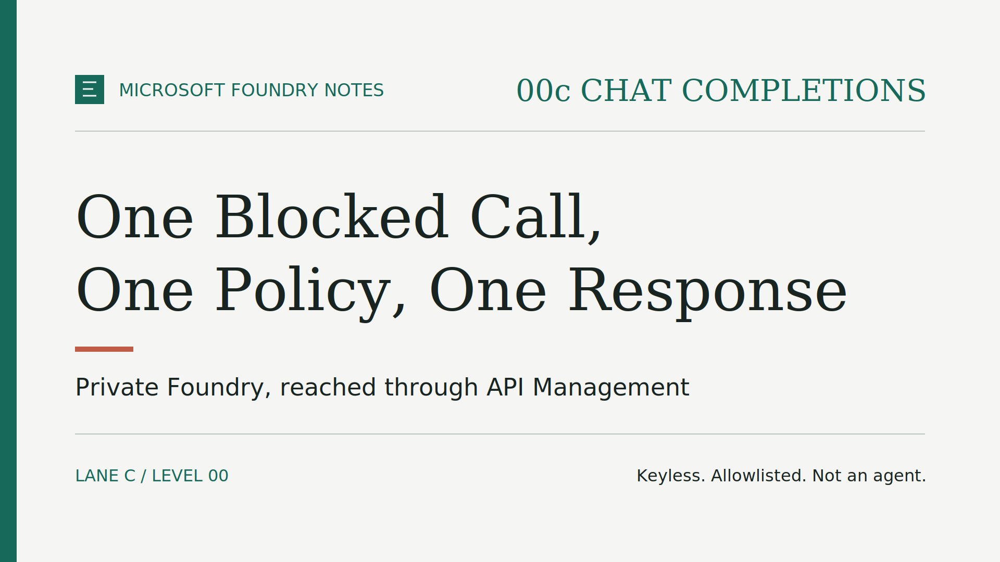

# Microsoft Foundry Notes: 00c Chat Completions — One Blocked Call, One Policy, One Response

The most useful first test of a private endpoint is a call that fails. If a
direct request from the internet still gets an answer from your model, the
network boundary is not doing its job, and nothing built on top of it can fix
that.

In [Private by Design, Reachable by Gateway](episode-00c-foundry-core-byo-vnet.md),
we deployed Microsoft Foundry Core inside a customer-managed virtual network
(VNet), with an API Management gateway as the only way in. This companion tests
that design with the **same** local Python command used in
[00a Chat Completions](published/episode-00a-chat-completions.md): one prompt, one
response, now aimed at two different targets.

> **TL;DR**
>
> - **Same app, same prompt:** no new client. You tell the command which lane
>   to read and whether to call Foundry directly or through the gateway.
> - **Blocked first:** the direct call to Foundry returned 403, because public
>   network access is disabled.
> - **One policy:** a separate step installs the gateway rules that check the
>   caller and switch to the gateway's own identity.
> - **Then one response:** the same call through API Management reached the
>   model over the private endpoint and answered.
> - **Still not an agent:** one request, no tools, no retrieval, no memory.

## Before you start: this episode needs lane 00c

The command is not standalone. It reads the Foundry account, the model
deployment name, and the gateway address from the environment created when
lane 00c was deployed. Without that deployment, there is nothing to call.

Two preparations matter before the gateway test:

- **Your object ID is in the allowlist.** The gateway accepts only Microsoft
  Entra ID object IDs listed in the lane configuration, and it reads that list
  when the policy is applied. The list starts empty, which denies everyone. An
  application client ID, an email address, or a key will not work.
- **Azure CLI is signed in as that person.** The command uses the signed-in
  Azure CLI user, as in 00a. No API key is read, stored, or passed around.

Lane 00a keeps working exactly as before. The lane option defaults to 00a, the
command still calls the public Foundry endpoint directly there, and it refuses
the gateway target, because 00a has no gateway.

## The test path

*Three steps, one boundary at a time: the network first, then the gateway
rules, then the full path.*

## Step 1: call Foundry directly, and expect a failure

My first direct call never reached Azure. The command stopped with a
configuration error before it asked for a token. The first version of the
shared command looked for the deployment environment one folder above the
lanes, where no deployment project exists. Deployment environments are stored
per lane, and the same environment name can exist in more than one lane, so
there was no safe place to guess from. The fix was to make the lane an
explicit choice, defaulting to 00a so that the existing episode is unchanged.

> **Lesson:** when one client serves several deployments, make it say which
> one it is talking to. A silent guess is how a test ends up hitting the wrong
> environment.

With lane 00c selected and the default direct target, the command builds the
same OpenAI v1 address used in 00a, from the Foundry account name. From my
laptop, that name resolved to a public address, and the service answered:

*403: Public access is disabled. Please configure private endpoint.*

No model response. Depending on your network, you may see a connection error
instead; either way, nothing should come back from the model.

Read the message, not just the status code. In 00a, a 403 meant a missing
role. Here it means the request came from the wrong network. Granting a role
would not change the outcome, and that is exactly what a private endpoint
should guarantee.

If a model response does come back, stop. Check public network access and the
private endpoint before going further.

## Step 2: apply the gateway policy

After the deployment, the gateway already has its API, its managed identity,
and its role on Foundry, but no policy. Apply it with the script described in
the lane README. The script reads the lane environment, validates the
allowlist, and installs the policy on the Chat Completions API.

The policy does four things, in this order:

1. **Validates the caller's token.** No valid Microsoft Entra ID token for
   Microsoft Foundry means **401**.
2. **Checks the allowlist.** A valid token whose object ID is not listed means
   **403**.
3. **Switches identity.** The gateway obtains a token for its own managed
   identity, which holds the **Cognitive Services OpenAI User** role.
4. **Replaces the credentials.** The caller's authorization is overwritten and
   any API key header is removed before the request leaves the gateway.

The caller is authorized at the gateway; the gateway is authorized at the
model. Neither credential crosses the boundary meant for the other.

## Step 3: call through the gateway

Run the same command, with the same prompt, choosing the gateway target. This
time the client calls the API Management address instead of the Foundry one.
The prompt asked the model to reply with exactly "Hello from Foundry.", and it
did.

That response proves a specific chain:

1. Azure CLI issued a token for you.
2. The gateway accepted the token and found your object ID in the allowlist.
3. The gateway obtained a token for its managed identity.
4. Inside the VNet, the private DNS zones resolved the Foundry name to the
   private endpoint.
5. Foundry accepted the gateway's role, and the model deployment answered.

The gateway also adds a response header with its own name, so the extra hop
is visible in the response headers.

Two more checks complete the picture. A request to the gateway without a
token, or with a malformed one, returned 401. And the direct call to Foundry,
repeated after the policy was in place, still returned 403: the policy opened
one controlled path, not the private endpoint.

## Where it fails tells you where to look

- **The direct call answers:** the private boundary is not enforced. Fix that
  first.
- **401 from the gateway:** the command could not present a valid token. Check
  the Azure CLI sign-in.
- **403 from the gateway:** the token is valid, but its object ID is not in the
  allowlist, or the policy was applied before the allowlist was updated.
  Update the allowlist and apply the policy again.
- **The gateway cannot reach the backend:** check the gateway VNet mode, the
  subnet NSG, the private DNS links, and the private endpoint approval.
- **401 or 403 coming back from Foundry through the gateway:** check the
  gateway's role assignment and allow time for it to propagate.
- **A text response:** this one path works, for this one caller.

## Try it yourself

The [episode-00c-chat-completions-v1.0.0 release](https://github.com/gderossilive/msfoundrynotes/releases/tag/episode-00c-chat-completions-v1.0.0)
contains the procedure and commands; this article summarizes the steps.

1. **Deploy lane 00c.** Follow the lane README. API Management activation
   takes most of the time: about half an hour in my run.
2. **Prepare the command.** Follow the README in the level 00 app folder:
   create a Python virtual environment and install its dependencies.
3. **Run the direct test** with lane 00c selected and confirm that no model
   response comes back.
4. **Add your object ID to the allowlist, apply the policy, then run the
   gateway test** with the same prompt.
5. **Clean up.** Remove the lane 00c deployment and verify that the resource
   group is gone. API Management Developer is billed while it exists, and each
   model call can incur charges.

Use synthetic prompts only. A private model behind an authenticated gateway is
a better starting point, but not, by itself, a setup approved for sensitive or
production data.

> **Validation status.**
>
> The full sequence ran live on 1 October 2026, in Italy North: the direct
> call returned 403, the gateway returned 401 without a valid token, and the
> allowlisted call through the gateway returned the expected answer. **One
> case was not exercised:** a valid token from an identity outside the
> allowlist, which the policy should reject with 403. One synthetic run is
> evidence for this path, not a guarantee for yours: run the three steps in
> your own environment before relying on them.

## What this does not prove

> **One request, through one explicit path. Then the program exits.**

- **Not an agent:** no planning, tools, retrieval, memory, or live data.
- **Not agent outbound isolation:** nothing here controls where a future agent
  can connect.
- **Not hybrid connectivity:** no VPN, ExpressRoute, or peered network is
  involved.
- **Not production:** the Developer tier has no service-level agreement, and
  there is no telemetry, rate limiting, or retry policy.

## What comes next

Two lanes of level 00 now share one client and one lesson: deciding *where* a
caller is authorized matters as much as deciding *whether*.

**What would you add first in front of a private model: A) per-caller token
limits, B) gateway telemetry, or C) a first agent? Tell me in the comments.**

## Further reading

- [Configure network isolation for Microsoft Foundry](https://learn.microsoft.com/azure/foundry/how-to/configure-private-link)
- [Authenticate and authorize access to LLM APIs with API Management](https://learn.microsoft.com/azure/api-management/api-management-authenticate-authorize-ai-apis)
- [Validate Microsoft Entra token policy](https://learn.microsoft.com/azure/api-management/validate-azure-ad-token-policy)
- [Authenticate with managed identity policy](https://learn.microsoft.com/azure/api-management/authentication-managed-identity-policy)
- [Work with chat completion models](https://learn.microsoft.com/azure/foundry/openai/how-to/chatgpt)
