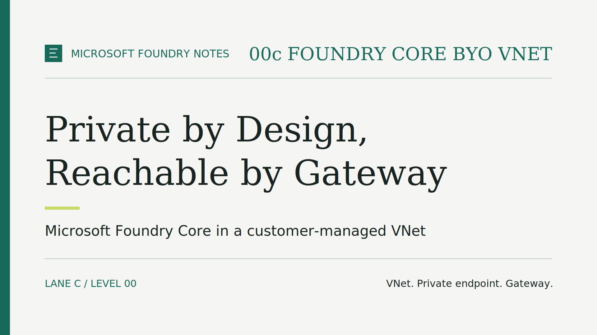

# Microsoft Foundry Notes: Private by Design, Reachable by Gateway

Turning off public access to a Microsoft Foundry resource takes one setting.
Making the model usable again, for the right callers only, takes a network, a
name-resolution plan, and a second identity.

In [Three Resources, One Model, No Agent Yet](published/episode-00a-foundry-core.md), we
built Microsoft Foundry Core with a public endpoint: reachable from anywhere,
but never anonymous. This episode keeps the same three Foundry resources and
moves the front door. The model endpoint becomes private, inside a
customer-managed virtual network (VNet), and a gateway becomes the one explicit
way in for testing.

> **TL;DR**
>
> - **Same core, new boundary:** one Foundry resource, one project, one model
>   deployment, with public network access disabled.
> - **Your network:** the scenario creates the VNet, two subnets, a network
>   security group, a private endpoint, and three private DNS zones in your
>   subscription.
> - **One way in:** API Management Developer receives authenticated requests
>   and reaches the model privately, from inside the VNet.
> - **Two identities:** the caller is checked at the gateway; the gateway's own
>   managed identity is authorized on Foundry. No API keys anywhere.
> - **Still no agent:** private inbound access to a model is not agent outbound
>   isolation.

## Where this scenario fits

Each scenario in the series is a numbered **level**, and a letter identifies
its network **lane**: **a** for public access, **b** for a Microsoft-managed
network, and **c** for a customer-managed VNet. Lane 00c is the "bring your
own VNet" variant of level 00.

"Bring your own" describes responsibility, not reuse. The template creates a
new VNet in your subscription; it does not attach to an existing one. From that
point on, its address space, routing, name resolution, and lifecycle are yours.

The scenario still focuses on **Models**: making a deployed model callable.
Agents, tools, retrieval, and business data stay out of scope.

## What gets deployed

*Microsoft Foundry Core in a customer-managed VNet. The only working path to
the model runs through the gateway and the private endpoint.*

**The Foundry core, unchanged from 00a.** One Microsoft Foundry resource, one
project, and one model deployment, with key-based authentication disabled. The
only difference is that **public network access is disabled**: the model is
not callable from the internet, whatever the caller's permissions.

**The network around it.**

- **VNet.** The private address space that hosts everything else.
- **Private endpoint subnet.** Hosts the private endpoint: a network interface
  with a private IP address that represents the Foundry resource inside the
  VNet.
- **Private DNS zones.** Three zones, one for each Foundry service name family,
  linked to the VNet. Inside it, the usual Foundry host names resolve to the
  private endpoint instead of a public address.
- **Gateway subnet and network security group (NSG).** A dedicated subnet for
  API Management, with the inbound and outbound rules that the service needs to
  operate.

**The test gateway.**

- **API Management Developer**, injected into the gateway subnet in
  **external** mode: its endpoint is reachable from the internet, while its
  outbound traffic flows through the VNet.
- **One API**, compatible with the OpenAI v1 Chat Completions path, pointing
  at the private Foundry endpoint.
- **A system-assigned managed identity** for the gateway, with the
  **Cognitive Services OpenAI User** role on the Foundry resource.

## Four details that are easy to miss

### 1. A private endpoint is only half the work

A private endpoint gives the Foundry resource a private IP address, but
applications call it by name, not by address. Without the private DNS zones
linked to the VNet, those names still resolve to the public address, where the
request is refused. In private networking, DNS decides the path.

This also explains why the scenario creates no VPN or ExpressRoute connection.
A client in another network would need both routing and DNS forwarding into
this VNet. Peering alone does not provide the second.

### 2. A private model does not need a private gateway

The Foundry endpoint is private; the gateway is not. That asymmetry is
intentional. API Management in external mode accepts requests from the
internet and forwards them through the VNet, so a reader can test the private
model from a laptop without building a VPN first.

This is a laboratory choice. The Developer tier has no service-level agreement
and is not meant for production. A production design would size and protect
the gateway separately, or keep it internal.

### 3. The gateway's identity is not the caller's identity

Two different questions are answered in two different places:

- **Who may call the gateway?** The gateway validates the caller's Microsoft
  Entra ID token and checks its object ID against an explicit allowlist. The
  allowlist starts empty: being signed in to the right tenant is not enough.
- **Who may call the model?** Only the gateway's managed identity holds the
  inference role on Foundry. The caller's token never reaches the model.

In 00a, the person who deployed the scenario received the inference role. In
00c, nobody does: the role belongs to the gateway alone.

### 4. Private inbound is not private outbound

This scenario controls how requests reach Foundry. It says nothing about how
a future agent would reach tools, data, or the internet. That outbound path
needs its own network design, covered when agents arrive in later levels.

## Why the gateway starts without a policy

The deployment creates the gateway, its API, its identity, and its role, but
deliberately leaves the API **policy** out. The policy is the set of rules
that authenticates callers and forwards their requests; without it, the
gateway cannot serve model calls.

That gap is the point of the companion episode. First, call the private
Foundry endpoint directly and watch it fail. Then apply the policy as a
separate, visible step and repeat the call through the gateway. Each step tests
one boundary at a time.

## What this scenario leaves out

- an agent, a hosted application, tools, retrieval, or business data;
- agent outbound isolation, firewalls, or egress control;
- VPN, ExpressRoute, peering, or a jump host inside the VNet;
- telemetry, gateway logging, rate and token limits, or caching; and
- a production-grade gateway tier.

Levels and lanes remain independent. Lane 00c does not change the public lane
00a, and you do not need 00a running to try it.

## Try it yourself

This is **Episode 00c** (episode-00c-foundry-core-byo-vnet), based on lane 00c
of level 00 in the
[episode-00c-foundry-core-byo-vnet-v1.0.0 release](https://github.com/gderossilive/msfoundrynotes/releases/tag/episode-00c-foundry-core-byo-vnet-v1.0.0).
This article summarizes the essentials; the lane README contains the complete
procedure and commands.

1. **Get the code.** Clone the complete repository rather than an isolated
   scenario folder: the infrastructure depends on shared modules and scripts.
2. **Check the prerequisites.** You need permission to create Foundry,
   networking, and API Management resources and to assign roles, plus model
   quota in your region. Locally, you need Bash, Git, jq, Azure CLI, Azure
   Developer CLI, and Bicep. Find the Microsoft Entra object ID of each person
   who will call the gateway: it goes in the allowlist.
3. **Deploy.** Follow the lane 00c README to configure the environment,
   including the gateway publisher contact and the allowlist, then provision.
   API Management with VNet injection takes considerably longer to provision
   than the Foundry resources: the whole deployment took about 32 minutes in
   my run, almost all of it gateway activation. Review model, private
   endpoint, and API Management Developer pricing first: the gateway is billed
   while it exists.
4. **Verify the boundary.** Confirm that public network access is disabled,
   the private endpoint connection is approved, the three DNS zones are linked,
   the gateway runs in external mode on its own subnet with an NSG, and its
   identity holds the inference role. A successful deployment does not prove
   that DNS, authorization, or inference work. That is the next episode.
5. **Clean up.** Follow the README cleanup procedure and verify that the
   resource group is gone.

**Validation status.** Lane 00c was deployed live on 1 October 2026 in Italy
North, and all 24 of the repository's live checks passed: public network access
disabled, key-based authentication off, private endpoint approved, three DNS
zones in its zone group, gateway in Developer tier and external mode on a
non-delegated subnet with its NSG, and the inference role on the gateway
identity. The deployment record covers configuration, not traffic; the
[00c Chat Completions companion](episode-00c-chat-completions.md) reports the
inference test. Run the verification steps in your own environment before
relying on the setup.

## What comes next

The [00c Chat Completions companion](episode-00c-chat-completions.md) runs the
same local application used in 00a against this deployment: first directly,
expecting a failure, then through the gateway once its policy is in place.

**For a private model in your own environment, where would you put the front
door: A) a gateway such as API Management, or B) a private client network such
as VPN or ExpressRoute? Tell me in the comments.**

## Further reading

- [Configure network isolation for Microsoft Foundry](https://learn.microsoft.com/azure/foundry/how-to/configure-private-link)
- [Microsoft Foundry architecture](https://learn.microsoft.com/azure/foundry/concepts/architecture)
- [What is a private endpoint?](https://learn.microsoft.com/azure/private-link/private-endpoint-overview)
- [Azure private endpoint DNS configuration](https://learn.microsoft.com/azure/private-link/private-endpoint-dns)
- [Use a virtual network with Azure API Management](https://learn.microsoft.com/azure/api-management/virtual-network-concepts)
- [Deploy API Management in an external virtual network](https://learn.microsoft.com/azure/api-management/api-management-using-with-vnet)
- [Authenticate and authorize access to LLM APIs with API Management](https://learn.microsoft.com/azure/api-management/api-management-authenticate-authorize-ai-apis)
