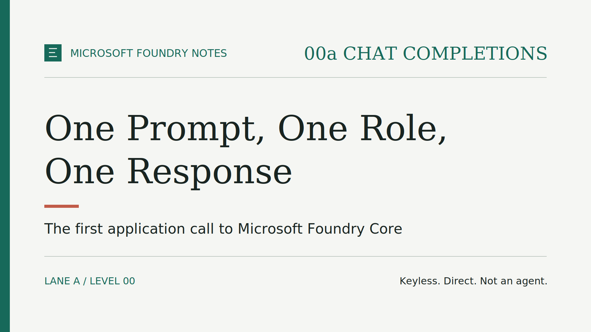

# Microsoft Foundry Notes: 00a Chat Completions — One Prompt, One Role, One Response

My first call to a freshly deployed model returned **401 PermissionDenied**, even
though the right role assignment was already in place. The model was fine. The
identity making the call was not the one I thought.

In [Three Resources, One Model, No Agent Yet](episode-00a-foundry-core.md), we
built Microsoft Foundry Core: one Foundry resource, one project, one model
deployment. Episode 00a Chat Completions adds the smallest possible application
on top of it: a local Python command that sends **one prompt** and prints **one
response**. Small enough to understand completely, and still enough to surface
the identity details that matter.

> **TL;DR**
>
> - **Deployment first:** this episode requires Microsoft Foundry Core, scenario 00a,
>   already deployed. It creates no separate environment.
> - **One prompt, one response:** a local Python command, not a hosted application.
> - **Keyless:** a Microsoft Entra ID token for the signed-in Azure CLI user. No API key.
> - **Deploying is not calling, now automated:** scenario 00a grants the deployer the
>   Cognitive Services OpenAI User role on the Foundry resource.
> - **Not an agent:** no tools, retrieval, memory, or live data. Answers come
>   from what the model learned during training.

## Before you start: this episode needs Foundry Core

The code is deliberately not standalone. It reads the Foundry account name and
the model deployment name from the environment created when scenario 00a was
deployed. Without that deployment there is no endpoint to call, no deployment
to select, and no resource on which to authorize the caller.

After deployment, the Azure side contains only:

- one Microsoft Foundry resource;
- one project;
- one model deployment; and
- one role assignment that lets the deployer call the model.

The Python command runs on your machine and deploys no compute. Model calls
can still incur charges, and the selected model, region, and capacity need
available quota.

## Deploying is not calling, now in code

Creating a Foundry resource and invoking its model are different permissions.
You can be allowed to deploy a model and still be refused when you call it.
The previous episode made that point; this one turns it into automation.

When you prepare scenario 00a, the setup script now:

1. checks that Azure CLI is signed in as a **human user**;
2. reads that user's Microsoft Entra object ID;
3. binds the ID to the scenario's local environment, so a later run cannot silently
   grant access to someone else; and
4. passes it to the infrastructure template, which assigns **Cognitive Services
   OpenAI User** on the Foundry resource.

Two limits are intentional. The person deploying still needs permission to
create role assignments. Service principals and CI pipelines are out of scope
for this tutorial.

## The request path

*One local process authenticates, calls the public Foundry endpoint, selects
the model by deployment name, and prints one response.*

Three details are worth noticing:

- **Endpoint:** the client builds the OpenAI v1 address from the account name,
  in the form https://your-account.services.ai.azure.com/openai/v1/.
- **Token:** it asks Microsoft Entra ID for a token scoped to Microsoft Foundry.
  No key is read, stored, or passed around.
- **Deployment name, not model name:** the request names the deployment exposed
  by the scenario, not the catalog model behind it. The infrastructure can
  change the model or version while the application contract stays the same.

For a deeper, step-by-step explanation of the script's structure,
authentication flow, endpoint selection, validation, and error handling, see
[How `chat_completions.py` works](../../scenarios/00-foundry-core/app/chat_completions-explained.md).

## The 401 that taught me the most

The first end-to-end run failed with 401 PermissionDenied. The role assignment
existed, and it belonged to my user. I waited for Azure role propagation and
tried again. It still failed.

The cause was the credential, not the role. The first version of the client
used DefaultAzureCredential, which tries several credential sources in a fixed
order. Environment and managed identity credentials come **before** Azure CLI.
In my development container, it found another identity first, and that
identity had no access to the model.

The fix was one line: use AzureCliCredential, so the token always belongs to
the signed-in user that scenario 00a authorized. The next call returned the
expected answer.

> **Lesson:** a flexible credential chain is convenient when code moves between
> environments. In a tutorial, it can hide which identity is actually calling.
> Pick the credential that matches the identity you authorized.

A hosted application would use its own managed identity instead of a person's
login. That is a later step in the series.

## Try it yourself

The public [Microsoft Foundry Notes repository](https://github.com/gderossilive/msfoundrynotes)
contains the procedure and commands. This article summarizes the steps.

1. **Get the code.** Clone the complete repository: the infrastructure depends
   on shared modules and scripts.
2. **Deploy Foundry Core.** Follow the scenario 00a README. Sign in to Azure CLI as
   the person who will call the model, run the setup script, then provision.
3. **Run one prompt.** Follow the README in the level 00 app folder: create a
   Python virtual environment, install the two dependencies (Azure Identity and
   the OpenAI Python library), then pass the environment name and a prompt such
   as "Explain Microsoft Foundry in one sentence."
4. **Read the answer critically.** In one run, the model replied:
   *"Microsoft Foundry is a managed Microsoft program and Azure-based platform
   that helps enterprises securely build, deploy, and govern scalable AI
   applications using Microsoft and third-party models and prebuilt tooling."*
   Fluent and plausible, but generated from training data, not read from the
   current product documentation.
5. **Clean up.** Remove the scenario 00a deployment when you finish. There is no
   separate application resource to delete.

If the call fails, where it fails tells you where to look:

- **before authentication:** wrong or missing environment, or an environment
  from another scenario;
- **while obtaining a token:** Azure CLI is not signed in;
- **401 or 403 from the endpoint:** the calling identity lacks the role, or the
  new assignment has not propagated yet;
- **a text response:** the basic path from caller to model works.

Use synthetic prompts only. The endpoint is public but not anonymous; that
alone does not make the setup ready for sensitive or production data.

> **Unit tests are not an end-to-end validation.**
>
> They answer a narrower question: they mock the environment, identity, and
> model access to check configuration handling and the request shape.
>
> **Only a real call after deployment** verifies authentication, role
> propagation, network reachability, quota, and model behavior. My 401 is proof:
> every mocked test had passed.

## This is not an agent

> **One direct request to a model deployment. One response. Then the program exits.**

What this sample does **not** include:

- **Agent loop:** the model does not plan or perform multi-step work.
- **Tools or external APIs:** it cannot decide to call a tool or service.
- **Retrieval or grounding:** it does not search documents, websites, or business data.
- **Memory:** each run is independent; no conversation history is kept.
- **A Foundry agent:** none is created or invoked.
- **An application runtime:** it is a local command, not a deployed application.
- **Production features:** no streaming interface, retry policy, telemetry,
  gateway, secret store, or private endpoint.

### What the model can know

> **In this scenario, the model has no live or private data source.**

- It cannot look up current events.
- It cannot access private business information.
- It cannot know about changes after its training knowledge cutoff, unless you
  put them in the prompt.
- Its answer is generated from what it learned during training, **not** from a
  continuously updated factual database.

Treat every response as generated content. Validate facts that matter before
using an answer in a decision, a process, or a customer-facing result.

These omissions are what keep the lesson measurable: can one authorized caller
invoke the model deployed by scenario 00a?

## What comes next

One successful completion is the baseline for a direct model call. From here,
each step should be driven by a real requirement, not by the next feature on
the list.

**Which requirement would move you beyond this one-request client first:
A) private connectivity, B) centralized API control through a gateway, or
C) conversation state? Tell me in the comments.**

## Further reading

- [Azure OpenAI in Microsoft Foundry Models v1 API](https://learn.microsoft.com/azure/foundry/openai/api-version-lifecycle)
- [Work with chat completion models](https://learn.microsoft.com/azure/foundry/openai/how-to/chatgpt)
- [Authentication and authorization in Microsoft Foundry](https://learn.microsoft.com/azure/foundry/concepts/authentication-authorization-foundry)
- [Role-based access control for Azure OpenAI](https://learn.microsoft.com/azure/ai-foundry/openai/how-to/role-based-access-control)
- [Credential chains in the Azure Identity library for Python](https://learn.microsoft.com/azure/developer/python/sdk/authentication/credential-chains)
