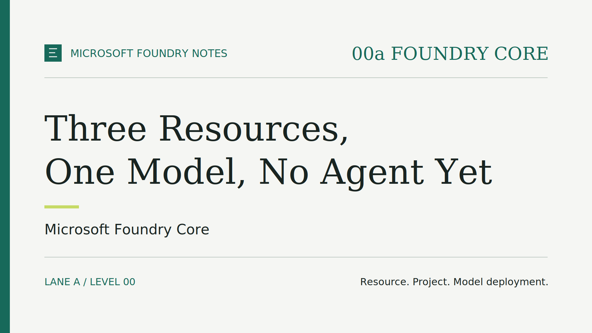
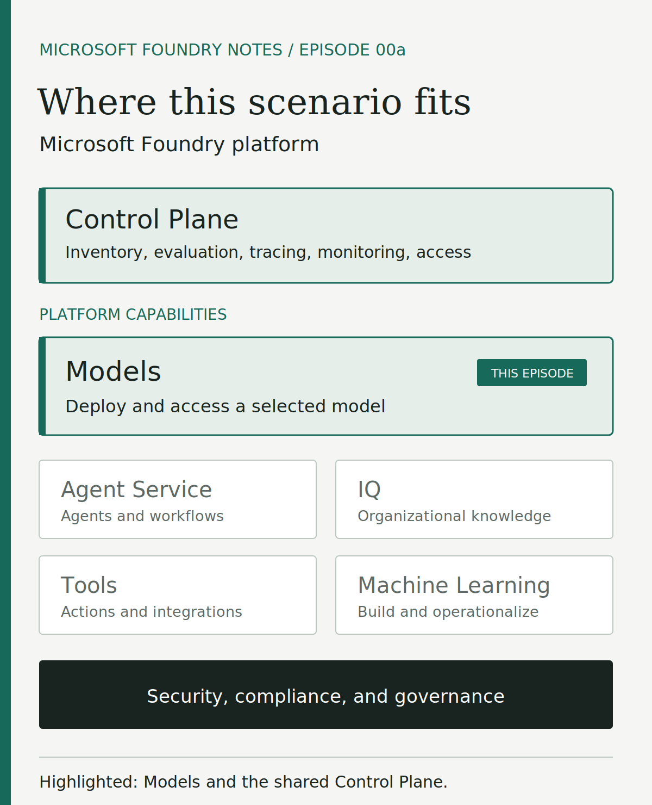
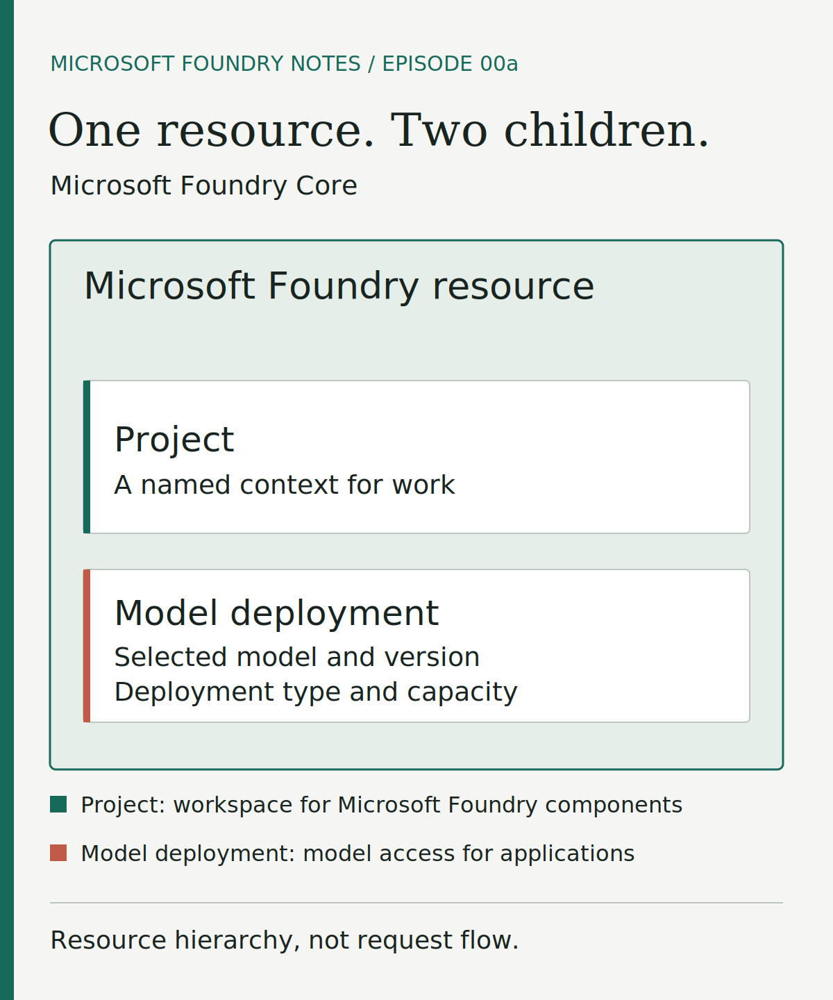
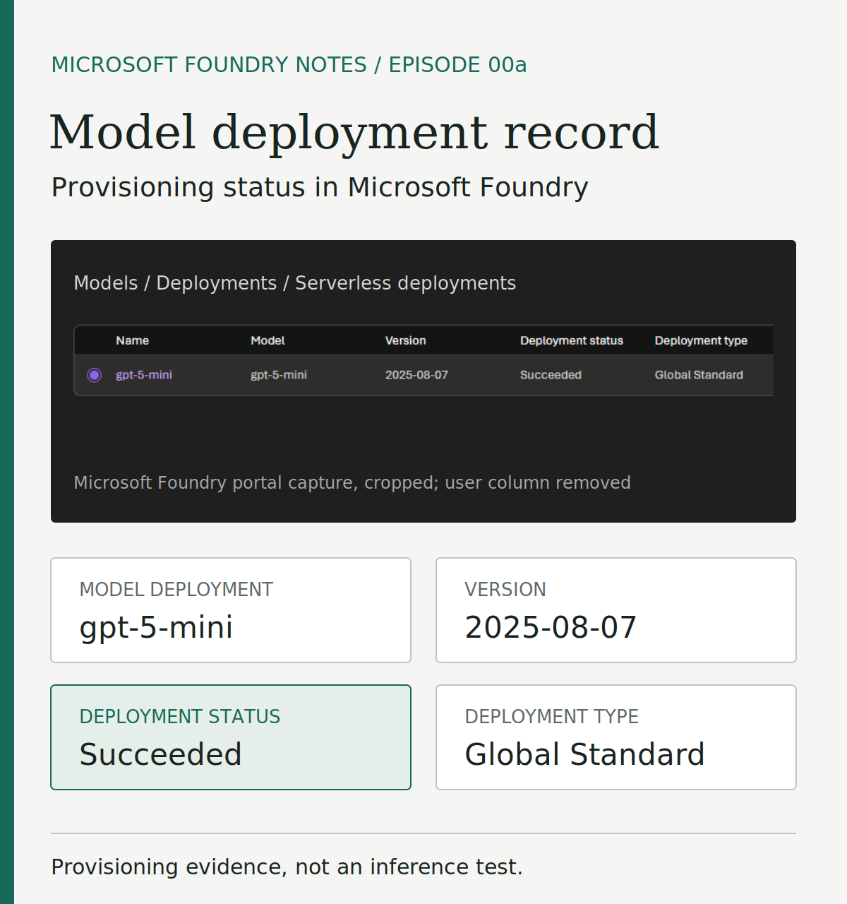

# Microsoft Foundry Notes: Three Resources, One Model, No Agent Yet

In Microsoft Foundry, permission to deploy a model does not include permission to
call it. That is by design, and it is one of several details worth understanding
before you add agents, tools, or business data.

Imagine a team exploring how a language model could support an internal process.
Before building an application, they need a small, repeatable starting point: a
model available through an API endpoint, the service address an application calls
to send input and receive a response. Agents, tools, business data, and stronger
network boundaries can follow when the requirements justify them.

This episode builds that starting point as a learning scenario called
**Microsoft Foundry Core**, which you can inspect and recreate from code.

> **TL;DR**
>
> - **Three resources:** one public Microsoft Foundry resource, one project, and
>   one model deployment. No agent or hosted application.
> - **Keyless access:** callers authenticate with Microsoft Entra ID and need their
>   own role to call the model.
> - **Public, not anonymous:** the endpoint is publicly reachable, but every call
>   still requires authorization.
> - **Provisioned, not yet proven:** a successful deployment is not a successful
>   inference call; that is a separate test.
> - **New Foundry:** like the rest of the series, it uses the new Microsoft
>   Foundry experience, not Foundry classic.

## Where this scenario fits

Within Microsoft Foundry, this scenario focuses on **Models**: making a selected
model available for an application to call. The shared **Control Plane** provides
inventory, evaluation, tracing, monitoring, and access management across Foundry
resources. Agent Service, IQ, Tools, and Machine Learning appear for context, but
are outside this scenario.

*Where this scenario fits in Microsoft Foundry: Models, supported by the shared Control Plane.*

## Three core resources, three different roles

The foundation consists of three core Foundry resources. Supporting Azure
resources, such as the resource group, sit outside this view.

- **Microsoft Foundry resource.** Called the account in the infrastructure code,
  it is the top-level resource. It contains the project and the model deployment
  and holds shared settings such as network access and authentication.
- **Project.** A development boundary where a team can organize application work
  and evaluations while reusing the resource's model deployments. Here, it
  provides a place for later development beyond the initial model call.
- **Model deployment.** It makes a selected model version available under a
  deployment name that applications use in their requests. Choosing the model
  determines what you use; configuring the deployment determines how you make it
  available.

Each request an application sends to that deployment is an **inference** request:
the model processes the input and returns a response.

The project and model deployment are siblings under the Microsoft Foundry
resource. The deployment is not nested inside the project.

*Microsoft Foundry Core resource hierarchy, not the path of a request to the model.*

For a deeper look at how these resources are defined and connected in Bicep, see
the [main.bicep learning guide](../../scenarios/00-foundry-core/00a-foundry-core-public/infra/main.md).
It walks through the current scenario template, including parameters, naming,
the shared module, role assignments, dependencies, and outputs.

## Four details that are easy to miss

### 1. Deploying a model is not permission to call it

Two identity paths matter. The account and project each receive a
**system-assigned managed identity**, which lets the resource authenticate to
other services but grants no permission on its own. The person or application
calling the model needs its **own** identity, authenticated with
**Microsoft Entra ID** because key-based authentication is disabled.

Authentication establishes who is calling; authorization determines what they can
do. In the pinned v1.0.0 package for this article, the template does not grant the
deploying user permission to invoke the model: permission to create resources is
not permission to use them. The caller needs a role such as **Cognitive Services
OpenAI User** on the Foundry resource. The later
[Chat Completions companion](episode-00a-chat-completions.md) updates the current
lane source to assign that role to its human Azure CLI deployer.

### 2. A European resource does not mean European processing

The **deployment type** determines the billing model, where inference data is
processed, and performance characteristics such as throughput and latency
variability. The example uses **GlobalStandard**, a pay-per-token option in which
inference data may be processed in any Azure region. Creating the resource in a
European region does not, by itself, keep prompt and response processing within
Europe.

The deployment also has a **capacity**, the request-processing throughput you
configure. It must fit within your subscription's **quota** for the selected
model, region, and deployment type.

### 3. Public does not mean anonymous

Network design determines how clients reach Foundry (**inbound access**) and how
agents reach tools and data (**outbound connectivity**). Lane 00a implements only
public inbound access, without VNet integration or a private endpoint. The
endpoint is public and not restricted by client IP address, but the Entra ID
requirements above still apply.

In the series, each scenario is a numbered **level**, and a letter identifies its
network **lane**: **a** for public access, **b** for a Microsoft-managed virtual
network (VNet) intended for agent outbound connectivity, and **c** for a
customer-managed VNet, where the customer is responsible for routing and private
connectivity. Level 00 is published only as lane 00a so far; lanes 00b and 00c
are planned for future episodes.

Isolating agent outbound traffic does not automatically make the Foundry endpoint
private. Private inbound access requires a **private endpoint**, a private network
access point to the service, together with restrictions on public access and
client connectivity.

### 4. Succeeded does not mean working

The portal capture below shows a lane 00a model deployment that provisioned with
status **Succeeded** on 27 September 2026.

*Record of successful model provisioning. The Succeeded status confirms the
deployment operation, but does not verify caller access or inference; those
require separate tests.*

## What this scenario leaves out

The infrastructure scenario deliberately leaves out:

- an agent or hosted application interface;
- connections to business data and dedicated search or storage services;
- an API gateway to control requests; and
- an Application Insights resource for traces and performance telemetry.

The result is a repeatable foundation, not a complete business application or a
production-ready system. A later local sample can call the deployed model without
adding an Azure application resource. Levels and lanes are independently deployable
alternatives: you will not need to keep these resources running to try a later
episode.

## Try it yourself

This is **Episode 00a** (episode-00a-foundry-core), based on lane 00a of level 00
in the public [msfoundrynotes repository](https://github.com/gderossilive/msfoundrynotes).
This article summarizes the essentials; the README files contain the complete
procedure and commands. The implementation and procedure links below are pinned
to the [published package](https://github.com/gderossilive/msfoundrynotes/tree/24db50895f4af989ca1a5de96e4145d74f922fa0)
at release tag [episode-00a-foundry-core-v1.0.0](https://github.com/gderossilive/msfoundrynotes/releases/tag/episode-00a-foundry-core-v1.0.0).

1. **Get the exact version.** Start with **Get this version** in the
   [release notes](https://github.com/gderossilive/msfoundrynotes/releases/tag/episode-00a-foundry-core-v1.0.0).
   Use its version-specific clone command in place of the unversioned git clone
   in the README. Clone the complete repository rather than an isolated scenario
   folder: the infrastructure depends on shared modules and scripts.
2. **Check the prerequisites.** You need an Azure subscription with the required
   resource providers registered and sufficient model quota, and permission to
   create a resource group and its resources. Locally, you need Bash on Linux,
   macOS, or WSL with Git and jq, plus Azure CLI, Azure Developer CLI, and Bicep.
   For inference, the calling identity needs the Cognitive Services OpenAI User
   role on the Foundry resource; if you cannot assign roles, ask someone who can.
3. **Deploy.** Follow
   [Deploy the public variant](https://github.com/gderossilive/msfoundrynotes/blob/24db50895f4af989ca1a5de96e4145d74f922fa0/README.md#deploy-the-public-variant)
   for local configuration, sign-in, bootstrap, and provisioning, and never commit
   credentials. The defaults are gpt-5-mini, version 2025-08-07, GlobalStandard,
   and capacity 30 (30,000 tokens per minute), configurable through environment
   variables. They are examples, not guarantees of availability, so check
   availability, quota, and pricing first. The bootstrap script tags the resource
   group SecurityControl=Ignore. This tag is not itself an Azure Policy exemption;
   review it with your policy owner before use.
4. **Verify.** Confirm that provisioning succeeded and that the outputs listed in
   the [lane 00a README](https://github.com/gderossilive/msfoundrynotes/blob/24db50895f4af989ca1a5de96e4145d74f922fa0/scenarios/00-foundry-core/00a-foundry-core-public/README.md)
   match your choices. Check that public network access is enabled, local
   authentication is disabled, and the managed identities exist. Then follow the
   [testing guide](https://github.com/gderossilive/msfoundrynotes/blob/24db50895f4af989ca1a5de96e4145d74f922fa0/docs/testing.md)
   and, signed in as the authorized caller, send a request to the named
   deployment. A returned answer checks the path from caller to model. If it
   fails, check model availability and quota, the caller's role, and connectivity
   before changing the architecture.
5. **Clean up.** Follow the README cleanup procedure and verify that the lab
   resources are gone. Cloud experiments can incur charges.

**Validation status.** At the pinned commit, the repository records passing
static checks: the lane 00a suite, parameter compilation, and the bootstrap and
metadata tests. The portal capture above shows one successful provisioning of
lane 00a. This article does not report a tested inference result, so run step 4
in your own environment before relying on the setup.

## What comes next

Level 00 spans several episodes. The
[Chat Completions companion](episode-00a-chat-completions.md) introduces the
application-level query, while later episodes can explore network lanes 00b and
00c. After that,
the series follows the path set out in the introduction: agents, identity,
networking, gateways, and tools, with one or more episodes for each level.
Each episode will add one capability or network boundary and examine the
responsibilities it brings.

For now, the useful outcome is knowing what you deployed, why each resource is
there, and which requirements remain deliberately unaddressed.

**Which requirement would you address next in your own context: A) private
access, or B) the first agent? Tell me in the comments.**

## Further reading

- [Use chat completions models in Microsoft Foundry](https://learn.microsoft.com/en-us/azure/foundry/openai/how-to/chatgpt)
- [Microsoft Foundry architecture](https://learn.microsoft.com/azure/foundry/concepts/architecture)
- [Create a project](https://learn.microsoft.com/azure/foundry/how-to/create-projects)
- [Model deployments overview](https://learn.microsoft.com/azure/foundry/concepts/deployments-overview)
- [Deployment types](https://learn.microsoft.com/azure/foundry/foundry-models/concepts/deployment-types)
- [Microsoft Foundry Control Plane](https://learn.microsoft.com/azure/foundry/control-plane/overview)
- [Managed identity types](https://learn.microsoft.com/en-us/entra/identity/managed-identities-azure-resources/overview#managed-identity-types)
- [Authentication and authorization in Microsoft Foundry](https://learn.microsoft.com/azure/foundry/concepts/authentication-authorization-foundry)
- [Azure Virtual Network overview](https://learn.microsoft.com/en-us/azure/virtual-network/virtual-networks-overview)
- [Virtual network integration in Microsoft Foundry](https://learn.microsoft.com/en-us/azure/foundry/concepts/architecture#virtual-network-integration)
- [Foundry Core level 00 README](https://github.com/gderossilive/msfoundrynotes/blob/24db50895f4af989ca1a5de96e4145d74f922fa0/scenarios/00-foundry-core/README.md)