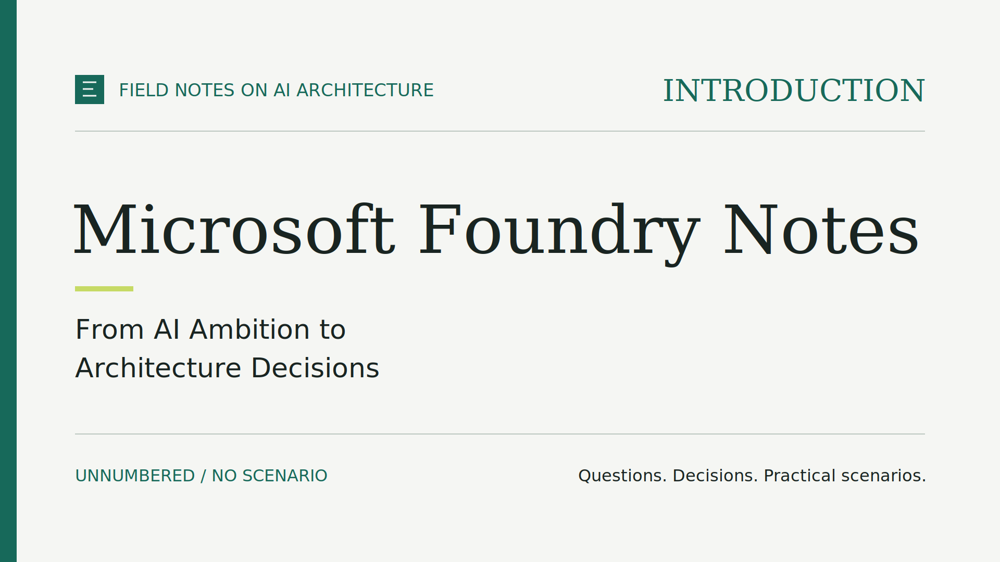
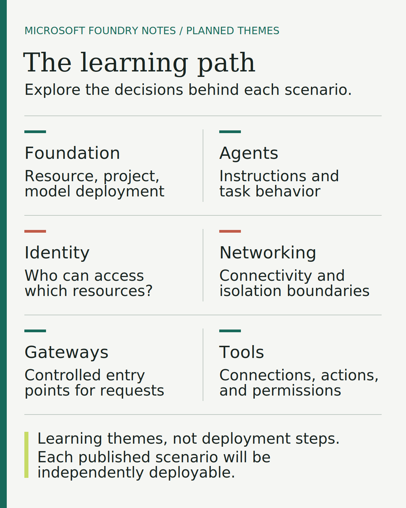

# Microsoft Foundry Notes: From AI Ambition to Architecture Decisions

## Why I am starting Microsoft Foundry Notes

Most AI conversations I have with customers start with a model. The harder
questions start right after.

Since changing roles on July 1, I have visited many customers to discuss how
artificial intelligence could make their internal processes more efficient, or
help rethink those processes altogether. Making an existing task faster can be
valuable. Reconsidering how information moves, how decisions are supported, or
how people interact with internal systems opens a different conversation.

During those meetings, I noticed that many customers were not yet familiar with
the possibilities Microsoft Foundry offers. That observation is the starting
point for this series.

I am calling it **Microsoft Foundry Notes**: a practical exploration of Microsoft
Foundry, guided by scenarios that matter to customers and the architectural
decisions behind them. The goal is to connect what AI could do for a business
with a clearer understanding of what we would actually need to build.

## The questions behind the technology

Whether the aim is to enrich employee experiences, reinvent customer engagement,
reshape business processes, or accelerate innovation, a model demonstration alone
cannot answer the questions that matter most:

- **Access.** What information should the system be allowed to see?
- **Capability.** Is calling a model enough, or does the task require an agent
  that can use tools?
- **Authority.** Who authorizes those tools to act?
- **Oversight.** Where should a person review the result before anything changes?

Consider a hypothetical approval process. A model could summarize each request
and highlight missing information. An agent could also look up the related
contract or open a ticket. Each step adds value, and each raises new questions:
which data can it read, which systems can it change, and who makes the final
decision?

These questions connect a business objective to concrete design choices, rather
than selecting features first and looking for a problem afterwards. They also
frame the trade-offs: a simpler architecture may be the right place to start,
while another context may require stronger isolation or tighter access control
from the beginning.

## What Microsoft Foundry Notes will explore

[Microsoft Foundry](https://learn.microsoft.com/azure/foundry/what-is-foundry)
brings together models, agents built with Agent Service, tools, IQ for
organizational knowledge, and machine learning. A shared
[Control Plane](https://learn.microsoft.com/azure/foundry/control-plane/overview)
provides inventory, evaluation, tracing, monitoring, and access management, while
security, compliance, and governance span the platform. The series uses the new
Microsoft Foundry experience, not Foundry classic.

In plain terms, a model generates a response from the input it receives. An agent
can use a model together with instructions and configured tools to carry out a
task. The surrounding architecture determines how that system is accessed, what
it can reach, and how its behavior can be inspected. Each episode looks at why a
capability belongs in a design, what it makes possible, and what responsibilities
it introduces.

I am writing for developers and architects who want to experiment, and for
technical leaders and people exploring AI opportunities within their teams. You
can follow the reasoning without deploying anything; the practical episodes
provide a path into the implementation when you want to go deeper.

## A practical path, one scenario at a time

We start small: a Microsoft Foundry resource, a project, and a model deployment.
From there, the path moves into agents, identity, networking, gateways, and tools.
Each level can span several episodes. The foundation, for example, continues with
its network isolation variants and a first application that queries the model
before the path moves on to agents.

Each episode focuses on one scenario and a manageable set of decisions. What
changes when access must stay within a private network? When does an API gateway,
a controlled entry point for requests, become useful? What must be configured
before an agent can use a tool? As Microsoft Foundry introduces new features and
scenarios, the path will evolve to include them.

*Planned learning themes, not deployment dependencies.*

The progression is educational, not a chain of dependent deployments. Each
published scenario is independently deployable, with no need to keep earlier
resources running. Read the whole series, or jump to the episode that matches a
decision you face today. More components do not automatically mean a better
solution; the requirements should decide.

## What to expect

The articles explain the problem, the architecture, and the reasoning behind the
main choices. Practical episodes also summarize prerequisites, verification, and
cleanup, while the README files in the public
[msfoundrynotes repository](https://github.com/gderossilive/msfoundrynotes)
contain the complete procedure and commands. The details appear in both, at
different depths.

Four ground rules apply throughout:

- **Versioned.** Each practical episode points to a release and its matching
  README. You work from the complete repository at that version, including shared
  dependencies, rather than an isolated scenario folder.
- **Explicit status.** I distinguish what is implemented, what has been tested,
  and what is planned. Infrastructure for a tool, for example, does not mean an
  agent is already connected to it.
- **Learning, not production.** Applying a scenario to a real workload requires
  further attention to security, data handling, reliability, and cost.
- **Costs and change.** Cloud experiments can incur charges, and cleanup is part
  of the exercise. Model availability and platform features can change after an
  article is published.

New articles will follow as the series develops, allowing time to test each
scenario and incorporate your feedback.

## Where we start

Episode 00a, the first practical episode, explores **Microsoft Foundry Core**: a
Microsoft Foundry resource, a project, and a model deployment. It is the first of
several episodes on the foundation. There is no agent or complete business
application yet, just a chance to understand the role of each resource and the
decisions that later scenarios build on.

Bring a process you would like to improve, and a question about what it would
take to do so responsibly.

**What should we explore first through Microsoft Foundry Notes: A) an internal
process you want to improve, or B) an architectural decision you are facing?
Tell me in the comments.**