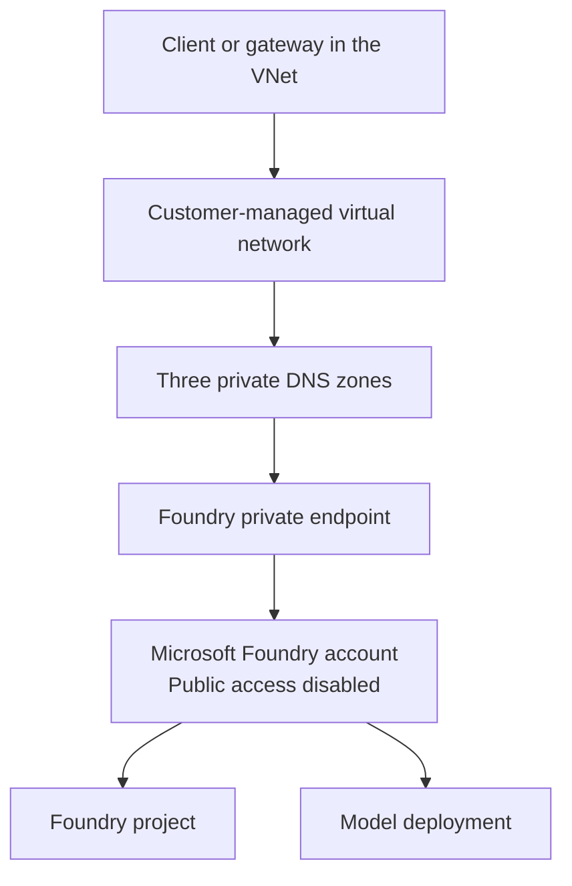

# Private Microsoft Foundry scenario

This guide explains, step by step, what [main.bicep](./main.bicep) deploys and why each resource is needed.

## Purpose

The module creates the infrastructure boundary for a Microsoft Foundry account that can be reached privately from a customer-managed virtual network.

The resulting design has four main characteristics:

1. The Foundry account does not accept public network traffic.
2. Clients inside the virtual network resolve Foundry host names to private IP addresses.
3. A private endpoint carries data-plane traffic from the virtual network to the Foundry account.
4. Local key authentication is disabled, so clients must use Microsoft Entra ID.

The module can also prepare a dedicated subnet and network security group for an API Management Developer gateway. It does **not** deploy the API Management instance itself.

## Deployment overview



At a high level, the template performs the following sequence:

1. Creates the virtual network and private endpoint subnet.
2. Optionally creates the API Management subnet and its network security group.
3. Creates and links the private DNS zones required by Microsoft Foundry.
4. Creates the Foundry account, project, and model deployment with public access and local authentication disabled.
5. Creates a private endpoint for the Foundry account.
6. Associates the private endpoint with the private DNS zones.
7. Returns the resource identifiers needed by the calling scenario.

Dependencies in Bicep are inferred from symbolic references. For example, the private endpoint receives the account name from the Foundry module and the DNS zone list from the DNS module, so it is deployed only after both are ready.

## 1. Deployment scope and inputs

The template uses:

```bicep
targetScope = 'resourceGroup'
```

All resources are therefore deployed into the resource group targeted by the parent deployment.

### Required parameters

| Parameter | Purpose |
|---|---|
| `location` | Azure region for the Foundry resources, virtual network, and private endpoint. |
| `namePrefix` | Prefix used to generate deterministic resource names. It must contain at least three characters. |
| `vnetAddressSpace` | Address space assigned to the customer-managed virtual network. |
| `privateEndpointSubnetPrefix` | Address prefix assigned to the private endpoint subnet. |
| `modelName` | Name of both the model and its deployment. |
| `modelVersion` | Version of the deployed model. |
| `modelSkuName` | Provisioning SKU for the model deployment. |
| `modelCapacity` | Capacity allocated to the model deployment. It must be at least `1`. |

### Optional parameters

| Parameter | Default | Purpose |
|---|---:|---|
| `enableApimDeveloperGateway` | `false` | Creates the subnet and network security group required by the API Management Developer gateway. |
| `apimSubnetPrefix` | `10.20.2.0/26` | Address prefix for the optional API Management subnet. |
| `enableManagedNetwork` | `false` | Enables Microsoft-managed network injection on the Foundry account. This does not create an agent or a separate managed network resource. |
| `modelFormat` | `OpenAI` | Provider format recorded on the model deployment. |

The supplied address prefixes must not overlap. Azure validates the relationship between the virtual network address space and its subnet prefixes during deployment.

## 2. Customer-managed virtual network

The `network` resource creates a virtual network named:

```text
<namePrefix>-vnet
```

Its address space comes from `vnetAddressSpace`. The template initially declares one subnet:

```text
private-endpoints
```

This subnet uses `privateEndpointSubnetPrefix` and disables private endpoint network policies:

```bicep
privateEndpointNetworkPolicies: 'Disabled'
```

Disabling these policies allows a private endpoint network interface to be placed in the subnet.

The `privateEndpointSubnet` declaration uses the `existing` keyword to obtain a symbolic reference to the subnet already created inside the virtual network. It does not create a second subnet. The reference is later used to pass the subnet resource ID to the private endpoint module.

## 3. Optional API Management network boundary

When `enableApimDeveloperGateway` is `true`, the template creates:

- a network security group named `<namePrefix>-apim-nsg`;
- an `apim` subnet using `apimSubnetPrefix`;
- an association between the subnet and the network security group.

When the parameter is `false`, none of these resources are deployed and the `apimSubnetId` output is an empty string.

### Inbound rules

| Rule | Source | Port | Reason |
|---|---|---:|---|
| `allow-client-https` | Internet | `443` | Allows clients to call the externally reachable API Management gateway over HTTPS. |
| `allow-apim-management` | `ApiManagement` service tag | `3443` | Allows the Azure API Management control plane to manage the instance. |
| `allow-azure-load-balancer` | `AzureLoadBalancer` service tag | `6390` | Supports the API Management load balancer health path. |

### Outbound rules

| Rule | Destination | Port | Reason |
|---|---|---:|---|
| `allow-certificate-validation` | Internet | `80` | Supports certificate validation. |
| `allow-storage` | `Storage` service tag | `443` | Allows access to Azure Storage dependencies. |
| `allow-sql` | `Sql` service tag | `1433` | Allows access to Azure SQL dependencies. |
| `allow-key-vault` | `AzureKeyVault` service tag | `443` | Allows access to certificates and secrets managed by Azure Key Vault. |
| `allow-monitor` | `AzureMonitor` service tag | `1886` | Allows Azure Monitor telemetry traffic. |
| `allow-monitor-https` | `AzureMonitor` service tag | `443` | Allows Azure Monitor traffic over HTTPS. |

The network security group supports the API Management Developer topology used by the scenario. It is not a general-purpose production network policy.

## 4. Private DNS

The `dns` module calls:

```text
../../private-network/foundry-private-dns/main.bicep
```

It creates the three private DNS zones required by the Foundry account:

- `privatelink.cognitiveservices.azure.com`
- `privatelink.openai.azure.com`
- `privatelink.services.ai.azure.com`

Each zone is linked to the customer-managed virtual network with registration disabled. The link allows resources using that virtual network's DNS resolution path to resolve Foundry host names to private endpoint IP addresses.

Private DNS is essential to the design. A private endpoint without the correct DNS configuration can exist successfully while clients continue resolving the public service address.

## 5. Foundry account, project, and model

The `foundryProject` module calls:

```text
../foundry-project/main.bicep
```

It creates:

- a Microsoft Foundry account;
- a Foundry project named from `core` plus a deterministic suffix;
- a model deployment using the requested model, version, SKU, and capacity.

The parent template deliberately passes:

```bicep
disableLocalAuth: true
publicNetworkAccess: 'Disabled'
```

These settings enforce two separate controls:

- `disableLocalAuth: true` disables key-based local authentication and requires Microsoft Entra ID authentication;
- `publicNetworkAccess: 'Disabled'` prevents data-plane access through the public network endpoint.

By default, the account and project receive system-assigned managed identities. The project principal ID is returned to the caller so that role assignments can be created at the scenario level.

If `enableManagedNetwork` is enabled, the Foundry account is configured for Microsoft-managed agent network injection. This flag alone does not deploy an agent and does not change the private inbound path created by this module.

## 6. Foundry private endpoint

The `privateEndpoint` module calls:

```text
../../private-network/foundry-account-private-endpoint/main.bicep
```

It creates a private endpoint in the `private-endpoints` subnet and connects it to the Foundry account by using the `account` private-link group.

The module then creates a private DNS zone group that associates the private endpoint with all three Foundry private DNS zones. Azure can consequently create and maintain the DNS records that map the service host names to the endpoint's private IP address.

This is the effective request path:

```text
Client in the VNet
  -> private DNS resolution
  -> private endpoint IP
  -> Foundry account
  -> model deployment
```

A direct call from the public Internet cannot use this path because public network access on the Foundry account is disabled.

## 7. Outputs

The module exposes the identifiers needed by scenario-level infrastructure, deployment scripts, and tests.

| Output | Meaning |
|---|---|
| `accountId` | Resource ID of the Foundry account. |
| `accountName` | Name of the Foundry account. |
| `projectId` | Resource ID of the Foundry project. |
| `projectName` | Generated name of the Foundry project. |
| `projectPrincipalId` | Principal ID of the project's managed identity. |
| `modelDeploymentName` | Name of the model deployment. |
| `vnetId` | Resource ID of the customer-managed virtual network. |
| `privateEndpointSubnetId` | Resource ID of the private endpoint subnet. |
| `privateEndpointId` | Resource ID of the Foundry private endpoint. |
| `apimSubnetId` | Resource ID of the optional API Management subnet, or an empty string when the subnet is disabled. |

## What this module does not do

The module intentionally has a narrow responsibility. It does not:

- deploy API Management;
- configure an API Management API or policy;
- grant a caller permission to invoke the gateway;
- create an agent;
- prove agent outbound isolation;
- deploy a VPN or ExpressRoute connection;
- provide a production-grade network design.

Those concerns belong to the calling scenario or to separate modules. This module provides the reusable private Foundry foundation: network, DNS, account, project, model deployment, and private endpoint.
